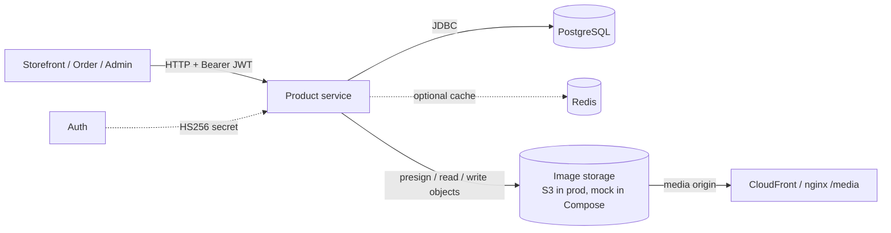

# Architecture

## Responsibilities

| Component | Owns |
| --- | --- |
| `api` | HTTP boundary, validation, status codes and stable error envelopes. |
| `service` | Business rules, idempotency replay and cache annotations. |
| `service/image` | `ImageStorage` abstraction with S3 and local-mock backends; presigning, validation fetch and display URLs. |
| `domain` | Persistence entities and Spring Data repositories. |
| `config` | Security, caching, request limits and transaction boundaries. |

Order calls Product; Product never calls Order. Besides PostgreSQL and the
optional Redis cache, Product calls the configured blob storage for image
uploads and reads (AWS S3 in production, the Compose image-storage mock
locally).

## Request flow

1. `RequestIdFilter` accepts or creates `X-Request-Id` and binds it to the log
   MDC.
2. `RequestSizeLimitFilter` rejects bodies larger than `MAX_REQUEST_BYTES`.
3. Spring Security validates the HS256 JWT and maps the `roles` claim directly
   to authorities.
4. The controller validates the JSON body at the HTTP boundary.
5. The service reads or writes PostgreSQL inside an explicit transaction.
6. Writes evict the product and product-list caches after a successful commit.
7. `ApiExceptionHandler` converts domain failures into stable JSON errors.

## Persistence and API separation

`Product`, `ProductImage`, `ImageUploadTicket` and `IdempotencyRecord` are
persistence entities. They are never serialized directly. The controller
returns `ProductResponse`/`ProductImageResponse` records and accepts
`ProductRequest`/`ImageUploadRequest`/`ImageAttachRequest`/`ImageAltRequest`
records, keeping the database schema decoupled from the published contract.

## Image flow

1. `POST /products/{id}/image/uploads` validates the declared metadata, stores
   a pending ticket with a `pending/products/...` key and returns a presigned
   PUT (`HttpImageStorage` returns a mock URL, `S3ImageStorage` a real S3 URL).
2. The client PUTs the bytes with `If-None-Match: *`.
3. `POST /products/{id}/image` reads the pending object, verifies length, real
   format and dimensions with ImageIO, copies the bytes to an immutable
   `media/products/...` key and attaches the row in one transaction. A previous
   image is replaced and its object deleted.
4. `displayUrl` derives the public URL from the configured media origin
   (CloudFront or the nginx `/media/` proxy); only object keys are stored.

`PATCH /products/{id}/image` edits alt text only; `DELETE` removes the object
and returns the product with `image: null`.

## Availability

- Liveness reflects the application process only.
- Readiness includes `readinessState` and the database health indicator.
- Redis is not part of readiness because it is an optional cache; a Redis
  outage degrades to database reads and increments cache-error metrics.
- PostgreSQL is required. When it is unavailable, requests return
  `503 DEPENDENCY_UNAVAILABLE` and readiness turns `DOWN`.

## Related decisions

- [Cache policy](cache.md)
- [Database and indexes](database.md)
- [Observability](observability.md)
